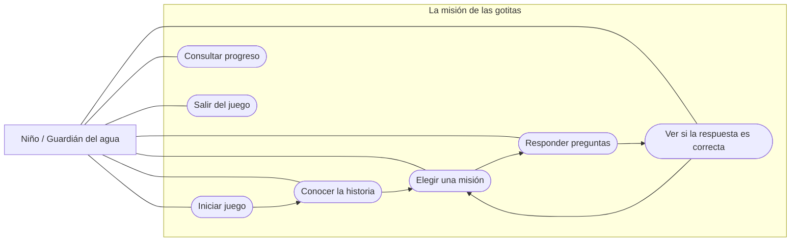
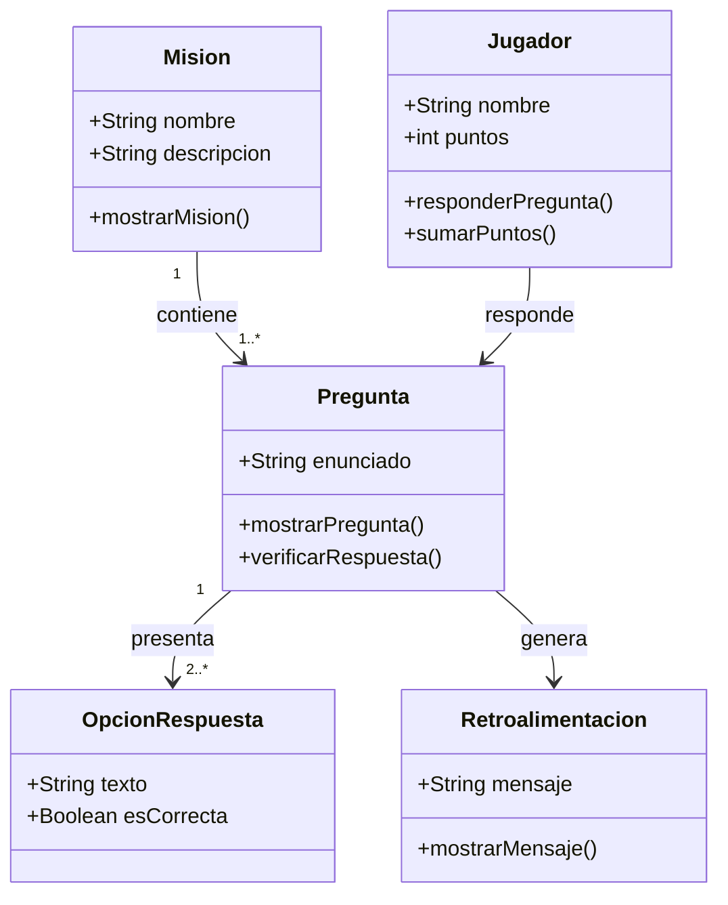

# La misión de las gotitas 💧

## Descripción del proyecto
La misión de las gotitas es un videojuego educativo diseñado para niños de 5 a 7 años. Su propósito es enseñar, de una manera sencilla, interactiva y divertida, la importancia de cuidar el agua potable y utilizarla responsablemente.

Mediante retos y actividades, el videojuego busca que los niños identifiquen acciones adecuadas para ahorrar agua y comprendan por qué este recurso es fundamental para la vida.

## Objetivo de Desarrollo Sostenible 6 (ODS 6)
El proyecto se relaciona con el ODS 6: Agua limpia y saneamiento, establecido por las Naciones Unidas. Este objetivo busca garantizar la disponibilidad de agua, su gestión sostenible y el saneamiento para todas las personas.

El videojuego contribuye a este propósito desde la educación, fomentando hábitos responsables desde la infancia.

---

## 1. Diagrama de Casos de Uso General

### Explicación:
Este diagrama muestra la interacción del jugador con el sistema: le permite iniciar el juego, elegir misiones y responder preguntas, mientras el sistema valida las respuestas y calcula su puntuación.

---

## 2. Diagrama de Clases 

### Explicación:
Muestra la estructura interna de clases del módulo, definiendo cómo la entidad `Mision` se compone de preguntas que el `Jugador` responde para recibir retroalimentación.
